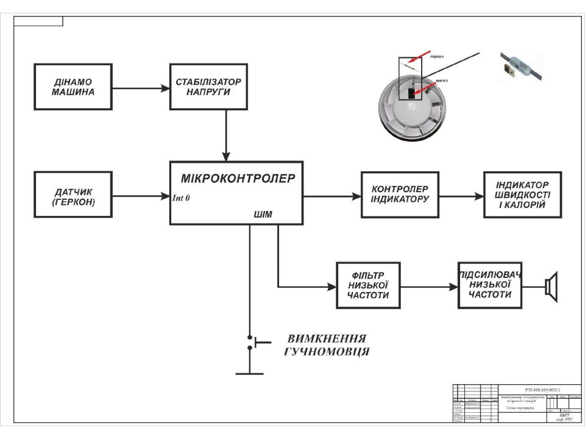

# AVR-Based Digital Speedometer & Calorie Tracker for Exercise Bikes

**Bachelor's Thesis** | *Graded 95/100*  
**Institution:** Odessa Polytechnic National University (2023)  
**Specialization:** Radioelectronic and Telecommunication Systems  

---

## 📌 Project Overview
This repository contains the complete hardware architecture, EDA simulation models, printed circuit board (PCB) layouts, and core firmware logic for a self-sustaining digital speedometer and calorie tracker designed for stationary exercise bikes. 

The system utilizes an **ATtiny2313 (8-bit AVR RISC MCU)**, incorporates a magnetic reed switch (gerkon) sensor for velocity logging (5 km/h to 100 km/h operational range), implements an energy-harvesting DC dynamo power delivery network, and features smart audio-tonal indication alongside an LCD telemetry display.

---

## 🛠 System Hardware Architecture

### 1. Structural Design & Power Management
Driven by a DC dynamo machine mounted on the bike wheel fork, the system features a custom voltage stabilization network. This subsystem regulates power fluctuations (5V to 15V over a 5 km/h to 100 km/h speed span) into a stable rails grid, protecting the liquid crystal display (LCD) and the MCU core.

### 2. Microcontroller Core Circuit
The design features an ATtiny2313 MCU clocked via an external 10MHz crystal oscillator (ZQ1) to ensure strict timing interval measurements and mitigate potential firmware execution locks. Data transfer to the liquid crystal telemetry display is executed via a synchronous serial (**SPI-formatted**) communication protocol topology.

### 3. Audio Frequency Conditioning & Power Amplifier
To assist the user in maintaining a steady workout pace, the firmware generates a rectangular audio waveform (meander) where the pitch frequency scales dynamically with the velocity target corridor. To suppress raw commutation overtones and deliver a clear harmonic wave, the signal passes through a calculated 8th-order Butterworth active Low-Pass Filter (LPF) utilizing AD812 op-amps and is driven via an SA58631 BTL audio power amplifier.

---

## 🔬 EDA Simulation & PCB Layout

### 1. Proteus VSM Virtual System Modeling
Full hardware-software interaction was simulated and validated in **Proteus VSM**. The simulation snapshot proves successful runtime tracking: operational speed at 36 km/h, timer at 732 seconds, and active dynamic calculation reaching `4432 Kcalories` on the virtual LCD interface.

| Simulation View: Idle (0 km/h) | Simulation View: Runtime (36 km/h) |
|---|---|
|  |  |

### 2. PCB Engineering & CAD Design
A compact double-sided printed circuit board layout (80x35 mm footprint) engineered and routed using the **DipTrace CAD suite**. It features optimized trace geometries for surface-mount technology (SMD 0805/1210 form factors) with a 2.56 mm coordinate matrix grid.

---

## 📊 Mathematical Modeling & Algorithmic Logic

### 1. Main Telemetry Flowchart & Interrupt Subroutines
The firmware structures asynchronous telemetry logging by capturing magnetic reed switch pulses on the `INT0` external interrupt vector. Timer/Counter 1 ticks a persistent 5-second sampling window to divide rotational counts, factor wheel diameter constants, and execute dynamic calculations.

| Main Application Loop | Interrupt Vectors (INT0 & TC1) |
|---|---|
|  |  |

### 2. Calorie Burn Approximation Metrics
The mathematical framework computes energy expenditure metrics in real time based on a tailored mathematical approximation model. The algorithm scales athlete body mass variables ($P$) directly against instantaneous velocity outputs ($V$):

$$\text{Energy Expenditure (kcal/min)} = 0.02P \times 14 \times 1.5 \times V_{\text{km/h}}$$

$$\text{Dynamic Integration Rate (kcal/sec)} = \frac{1}{60} \left[ 0.02P \times 14 \times 1.5 \times V_{\text{km/h}} \right]$$

---

## 📁 Repository Directory Structure
*   `/schematics` - Structural drawings, MCU core (SPI interfacing), audio amplifier circuit diagrams, and DipTrace PCB layout blueprints.
*   `/simulation` - Proteus VSM virtual validation logs, system run states, and terminal behavior captures.
*   `/documentation` - Main application loops, interrupt subroutine flowcharts, and mathematical calorie approximation tables.
